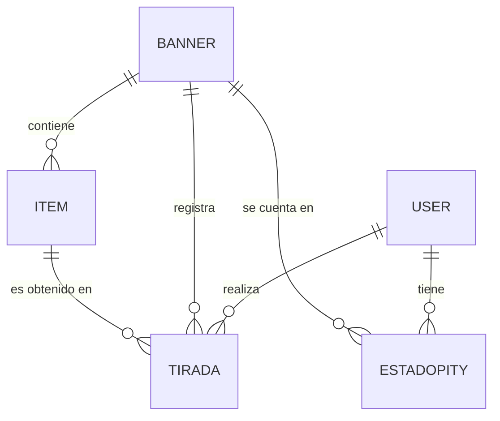

# WuWa Tracker — Evaluación 3 (Proyecto Integración de Programación, APR076)

Aplicación web en Django que simula las tiradas ("convocaciones") del juego *Wuthering Waves*
y registra el **pity** de cada usuario (contador de tiradas para asegurar un 5★), el historial y un
feed público de tiradas compartidas.

**Integrantes:** Vicente Gutiérrez y Luis Barros · **Docente:** Christian Fuentes Unda

## 1. Problema que resuelve

Los jugadores llevan el pity y el historial de sus tiradas "de memoria" o en planillas. La aplicación
permite simular tiradas con las reglas del juego, guarda el estado de cada usuario por banner y
muestra su historial. Cualquier visitante puede ver los banners y el feed público; **solo los usuarios
con sesión iniciada pueden tirar, ver su dashboard y compartir tiradas**.

## 2. Instalación y ejecución

Requiere Python 3.12 o superior.

```bash
# 1. Entorno virtual e instalación de dependencias
python -m venv venv
venv\Scripts\activate 
pip install -r requirements.txt

# 2. Base de datos (ya viene db.sqlite3 con datos de prueba; este paso la deja al día)
python manage.py migrate

# 3. Ejecutar
python manage.py runserver
```

Abrir <http://127.0.0.1:8000/>. La página usa Bootstrap y fuentes desde internet (CDN).

**Imágenes de los banners:** se guardan en la carpeta `media/`. Si esa carpeta viene vacía, las fotos
originales están en `imagenes_a_subir/` y se cargan con:

```bash
python manage.py shell < subir_imagenes.py
```

(en PowerShell: 'python manage.py shell -c "exec(open('subir_imagenes.py', encoding='utf-8').read())').
El script asocia cada foto con el item que tiene el mismo nombre.

**Si se parte con una base vacía** (en vez de usar `db.sqlite3`): `python manage.py migrate`,
luego `python manage.py loaddata datos_iniciales` (carga 3 banners y 26 items),
`python manage.py createsuperuser` y cargar las imágenes como se explicó arriba.

### Cuentas de prueba

| Usuario | Contraseña    | Tipo          |
|---------|---------------|---------------|
| vice    | ncvu0503 | superusuario  |
| luis    | ijlv7211 | superusuario  |

Son las cuentas de los integrantes. Al ser superusuarios también pueden entrar a `/admin/`, pero en la
aplicación se comportan como cualquier usuario con sesión iniciada.

## 3. Funcionalidades y rutas

| Ruta               | Acceso    | Qué hace                                                                 |
|--------------------|-----------|--------------------------------------------------------------------------|
| `/`                | público   | Catálogo de banners con sus items (5★ y 4★) y botones "Tirar x1 / x10" |
| `/feed/`           | público   | Últimas 20 tiradas compartidas por los usuarios                         |
| `/cuentas/login/`  | público   | Inicio de sesión                                                         |
| `/cuentas/logout/` | sesión    | Cierre de sesión (el botón de la barra lo envía por POST)               |
| `/simular/`        | **sesión**| Formulario de tirada manual (banner + cantidad). Se abre desde el botón ‘Simular tiradas’ del dashboard|
| `/resultado/`      | **sesión**| Resultado de la última simulación (guardado en la sesión)               |
| `/dashboard/`      | **sesión**| Pity actual por banner e historial de las últimas 30 tiradas            |
| `/compartir/<id>/` | **sesión**| (POST) publica una tirada propia en el feed                             |
| `/admin/`          | staff     | Administración de Django (apoyo; no reemplaza las páginas)              |

Las rutas protegidas redirigen al login también si se escribe la dirección directamente.

## 4. Estructura (MVT)

```
wuwa_tracker/        configuración (settings.py) y urls raíz
cuentas/             inicio y cierre de sesión
gacha/
  models.py          Banner, Item, EstadoPity, Tirada
  forms.py           SimularTiradaForm (validación en el servidor)
  pity.py            reglas del negocio: probabilidades, soft/hard pity, 50/50, pity de 4★
  views.py           vistas (catalogo, simular, resultado, compartir, dashboard, feed_publico)
  urls.py
  fixtures/          datos_iniciales.json
templates/           plantilla.html (base) + cuentas/ + gacha/
static/              estilos.css e imágenes de los banners
imagenes_a_subir/    fotos originales de los items
subir_imagenes.py    carga las fotos en media/
docs/                comprobaciones, contribuciones, fuentes, preparación de la presentación
```

Flujo de una tirada: `simular/` (URL) → vista `simular` → `SimularTiradaForm` (valida) →
`simular_tiradas()` en `pity.py` (regla de negocio) → modelos `EstadoPity` y `Tirada` (SQLite) →
redirección a `resultado/` → vista `resultado` + `resultado.html`.

## 5. Modelo de datos



- **Banner**: nombre, tipo (personaje / arma / permanente), descripción.
- **Item**: nombre, categoría, rareza (4 o 5), imagen, si es el destacado del banner.
- **EstadoPity** (único por usuario + banner): pity de 5★, pity de 4★, si el próximo 5★ está garantizado.
- **Tirada**: usuario, banner, item obtenido, pity en ese momento, resultado del 50/50, si fue compartida, fecha.

## 6. Reglas del negocio y validaciones

- Cantidad de tiradas: **solo 1 o 10**. El banner debe existir. Se valida **en el servidor**
  (`SimularTiradaForm`); si algo falla, se vuelve a mostrar el formulario marcando el campo que hay que corregir.
- Probabilidad base de 5★: 0,8 %. Desde la tirada 60 comienza el **soft pity** (la probabilidad sube) y en la
  tirada 80 el 5★ está **garantizado** (hard pity). Un 4★ está garantizado cada 10 tiradas.
- Banner de personaje: **50/50** entre el destacado y un 5★ del banner permanente; si se pierde, el siguiente
  5★ es el destacado. Banner de arma: siempre el arma destacada. Banner permanente: 5★ al azar.
- Solo se pueden compartir tiradas **propias** (si no, 404) y solo por POST.
- Todos los formularios llevan protección **CSRF**.

## 7. Comprobaciones

Las comprobaciones (acción, resultado esperado y observado) están en `docs/COMPROBACIONES.md`.

## 8. Limitaciones conocidas

- Las tiradas de 3★ no se guardan (solo cuentan para el pity); el contador de 3★ en la pantalla de resultado
  se calcula como *total pedido − 4★/5★ mostrados*.
- El banner de arma no replica el 75/25 del juego real (siempre entrega el arma destacada).
