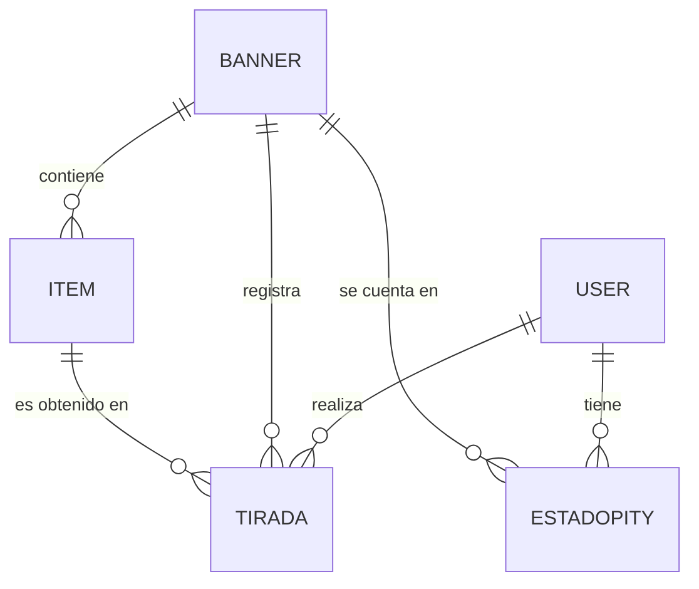

# WuWa Tracker — Evaluación 3 (Proyecto Integración de Programación, APR076)

Aplicación web en Django que simula las tiradas ("convocaciones") del juego *Wuthering Waves*
y registra el **pity** de cada usuario (contador de tiradas para asegurar un 5★), su historial y un
feed público de tiradas compartidas. Incluye un catálogo de personajes y armas que los usuarios con
sesión pueden ampliar desde la propia aplicación.

**Integrantes:** Vicente Gutiérrez y Luis Barros · **Docente:** Christian Fuentes Unda

## 1. Problema que resuelve

Los jugadores llevan el pity y el historial de sus tiradas "de memoria" o en planillas. La aplicación
permite simular tiradas con las reglas del juego, guarda el estado de cada usuario por banner y
muestra su historial.

| Usuario | Qué puede hacer |
|---------|-----------------|
| Visitante (sin sesión) | Ver el catálogo, el detalle de cada personaje o arma, los banners y el feed público |
| Usuario con sesión | Todo lo anterior, además de tirar, ver su dashboard, compartir tiradas y crear personajes o armas |

## 2. Instalación y ejecución

Requiere Python 3.12 o superior.

```bash

python -m venv venv
venv\Scripts\activate
pip install -r requirements.txt

python manage.py migrate

python manage.py runserver
```

Abrir http://127.0.0.1:8000/

**Datos e imágenes:** el proyecto incluye `db.sqlite3` (3 banners, 26 personajes y armas con su
descripción, y las cuentas de prueba) y la carpeta `media/` con las imágenes de cada item. Los items
creados sin imagen usan `media/sin_imagen.jpg`. No hay que cargar nada para usar la aplicación.

**Si se parte con una base vacía** (en vez de usar `db.sqlite3`):

```bash
python manage.py migrate
python manage.py loaddata datos_iniciales
python manage.py createsuperuser
```

`datos_iniciales` carga los 3 banners y los 26 items (con su slug, descripción, ataque base y la ruta
de su imagen en `media/`).

### Cuentas de prueba

| Usuario | Contraseña    | Tipo          |
|---------|---------------|---------------|
| vice    | ncvu0503 | superusuario  |
| luis    | ijlv7211 | superusuario  |

Cuentas de los integrantes. Al ser superusuarios también pueden entrar a `/admin/`, pero en la
aplicación se comportan como cualquier usuario con sesión iniciada.

## 3. Funcionalidades y rutas

| Ruta                    | Acceso     | Qué hace                                                                          |
|-------------------------|------------|-----------------------------------------------------------------------------------|
| `/`                     | público    | Catálogo de personajes y armas, con búsqueda, filtros, orden y paginación         |
| `/items/<slug>/`        | público    | Detalle de un personaje o arma: imagen, banner, rareza, ataque base y descripción |
| `/items/nuevo/`         | **sesión** | Formulario para crear un personaje o arma (con imagen, descripción y ataque base) |
| `/banners/`             | público    | Lista de banners                                                                  |
| `/banners/<id>/`        | público    | Detalle de un banner con sus items                                                |
| `/feed/`                | público    | Últimas 20 tiradas compartidas por los usuarios                                   |
| `/cuentas/login/`       | público    | Inicio de sesión                                                                  |
| `/cuentas/logout/`      | sesión     | Cierre de sesión (el botón de la barra lo envía por POST)                         |
| `/simular/`             | **sesión** | Formulario de tirada (banner + cantidad x1 o x10)                                 |
| `/resultado/`           | **sesión** | Resultado de la última simulación (guardado en la sesión)                         |
| `/dashboard/`           | **sesión** | Pity actual por banner e historial de las últimas 10 tiradas                      |
| `/compartir/<id>/`      | **sesión** | (POST) publica una tirada propia en el feed                                       |
| `/admin/`               | staff      | Administración de Django (apoyo; no reemplaza las páginas)                        |

Las rutas protegidas redirigen al login también si se escribe la dirección directamente.
El detalle de cada item se identifica con un **slug** (por ejemplo `/items/verdant-summit/`), que se
genera automáticamente a partir del nombre.

## 4. Estructura (MVT)

```
wuwa_tracker/        configuración (settings.py) y urls raíz
cuentas/             inicio y cierre de sesión
gacha/
  models.py          Banner, Item, EstadoPity, Tirada
  forms.py           SimularTiradaForm, ItemForm, FiltroCatalogoForm (validación en el servidor)
  pity.py            reglas del negocio: probabilidades, soft/hard pity, 50/50, pity de 4★
  views.py           vistas (catalogo, item_detalle, item_crear, banners, banner_detalle,
                     simular, resultado, compartir, dashboard, feed_publico)
  urls.py
  migrations/        incluye el campo slug y los campos descripcion y ataque_base de Item
  fixtures/          datos_iniciales.json
templates/
  base.html          plantilla maestra; todas las páginas la extienden
  includes/          fragmentos reutilizables (navbar, footer, mensajes, tarjeta de item, etc.)
  cuentas/ gacha/    una plantilla por página
static/              estilos.css, scripts JS e imágenes de los banners
media/               imágenes de personajes y armas (y sin_imagen.jpg)
docs/                comprobaciones y fuentes
```

Flujo de una tirada: `simular/` (URL) → vista `simular` → `SimularTiradaForm` (valida) →
`simular_tiradas()` en `pity.py` (regla de negocio) → modelos `EstadoPity` y `Tirada` (SQLite) →
redirección a `resultado/` → vista `resultado` + `resultado.html`.

Flujo de la creación de un personaje o arma: `items/nuevo/` (URL) → vista `item_crear`
(`@login_required`) → `ItemForm(request.POST, request.FILES)` (valida) → `form.save()` (guarda la
imagen en `media/` y el registro en SQLite; el modelo genera el slug) → redirección a
`items/<slug>/` → vista `item_detalle` + `item_detalle.html`.

## 5. Modelo de datos



- **Banner**: nombre, tipo (personaje / arma / permanente), descripción.
- **Item**: nombre, slug, categoría, rareza (4 o 5), imagen, ataque base (nivel 90), descripción, si es el
  destacado del banner y el banner al que pertenece.
- **EstadoPity** (único por usuario + banner): pity de 5★, pity de 4★, si el próximo 5★ está garantizado.
- **Tirada**: usuario, banner, item obtenido, pity en ese momento, resultado del 50/50, si fue compartida, fecha.

## 6. Reglas del negocio y validaciones

Todas se comprueban **en el servidor**; si algo falla, se vuelve a mostrar el formulario marcando el
campo que hay que corregir. Todos los formularios llevan protección **CSRF**.

**Simulación de tiradas** (`SimularTiradaForm`, `pity.py`)

- Cantidad de tiradas: **solo 1 o 10**. El banner debe existir.
- Probabilidad base de 5★: 0,8 %. Desde la tirada 60 comienza el **soft pity** (la probabilidad sube) y en la
  tirada 80 el 5★ está **garantizado** (hard pity). Un 4★ está garantizado cada 10 tiradas.
- Banner de personaje: **50/50** entre el destacado y un 5★ del banner permanente; si se pierde, el siguiente
  5★ es el destacado. Banner de arma: siempre el arma destacada. Banner permanente: 5★ al azar.
- Solo se pueden compartir tiradas **propias** (si no, 404) y solo por POST.

**Creación de personajes y armas** (`ItemForm`)

- Nombre: al menos 2 caracteres y distinto (sin importar mayúsculas) de cualquier item existente.
- Imagen (opcional): JPG, PNG o WEBP de hasta 2 MB. Si no se sube, se usa `sin_imagen.jpg`.
- Ataque base (opcional): número entero entre 100 y 800.
- Descripción (opcional): entre 10 y 600 caracteres.
- Un banner limitado solo admite items de su misma categoría (personaje o arma); el permanente admite ambas.
- Solo un 5★ puede ser el destacado, el banner permanente no tiene destacado, cada banner limitado tiene
  uno solo, y en un banner limitado el 5★ debe ser el destacado.
- Solo los usuarios con sesión pueden crear items (también se bloquea escribiendo la dirección directamente).

## 7. Comprobaciones

Las comprobaciones (acción, resultado esperado y observado) están en `docs/COMPROBACIONES.md`.
Las fuentes y herramientas utilizadas están en `docs/FUENTES.md`.

## 8. Limitaciones conocidas

- Las tiradas de 3★ no se guardan (solo cuentan para el pity); el contador de 3★ en la pantalla de resultado
  se calcula como *total pedido − 4★/5★ mostrados*.
- El banner de arma no replica el 75/25 del juego real (siempre entrega el arma destacada).
- Los personajes y armas se pueden crear, pero no editar ni eliminar desde la aplicación (solo desde `/admin/`).
- Las armas de la serie *Guardian* son de 3★ en el juego, pero en la aplicación están como 4★ porque
  el simulador solo maneja 4★ y 5★.
- El slug se genera al crear el item y no cambia aunque después se modifique el nombre.
- La aplicación corre en modo desarrollo (`DEBUG = True`): las imágenes de `media/` las sirve Django directamente.
