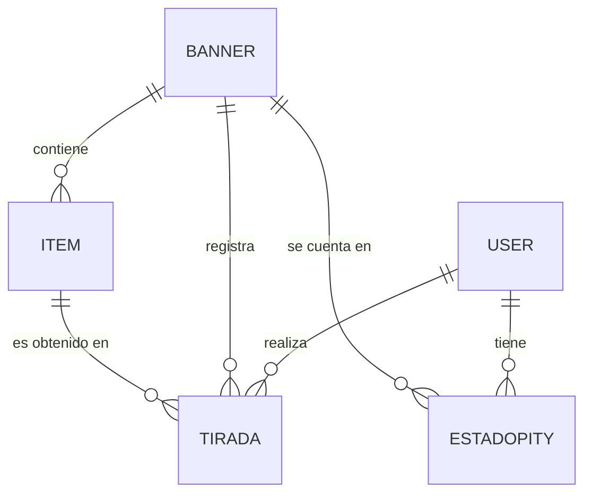

# WuWa Tracker — Evaluación 4 (Proyecto Integración de Programación, APR076)
 
Aplicación web en Django que simula las tiradas ("convocaciones") del juego *Wuthering Waves*
y registra el **pity** de cada usuario (contador de tiradas para asegurar un 5★), su historial y un
feed público de tiradas compartidas. En esta etapa se migró a **PostgreSQL** y se completó el **CRUD**
de las dos entidades de negocio (**Banner** e **Item**: personajes y armas) con perfiles y permisos.
 
**Integrantes:** Vicente Gutiérrez y Luis Barros · **Docente:** Christian Fuentes Unda
 
## 1. Problema que resuelve
 
Los jugadores llevan el pity y el historial de sus tiradas "de memoria" o en planillas. La aplicación
permite simular tiradas con las reglas del juego, guarda el estado de cada usuario por banner y
muestra su historial. El equipo que administra el contenido puede mantener el catálogo (banners,
personajes y armas) desde la propia aplicación, sin usar `/admin/`.
 
## 2. Perfiles y permisos
 
| Perfil | Cómo se define | Qué puede hacer |
|--------|----------------|-----------------|
| Visitante | Sin sesión | Ver catálogo, detalle de items, banners y feed |
| Jugador | Con sesión, `is_staff=False` | Lo anterior + tirar, ver resultado y dashboard, compartir tiradas |
| Staff | `is_staff=True` | Lo del jugador + ver las tablas de gestión y **editar** banners e items. No crea ni elimina |
| Administrador | `is_superuser=True` | Todo lo anterior + **crear y eliminar** banners e items |
 
Los permisos se comprueban **dentro de cada vista** (no solo ocultando botones), así que también
se aplican al escribir la dirección directamente: sin sesión se redirige al login y, con sesión pero
sin el perfil necesario, se responde **403** con una página propia.
 
## 3. Instalación y ejecución
 
Requiere **Python 3.12 o superior** y **PostgreSQL** instalado y en ejecución.
 
### 3.1 Entorno y dependencias
 
```bash
python -m venv venv
venv\Scripts\activate          # Windows (en Linux/Mac: source venv/bin/activate)
pip install -r requirements.txt
```
 
Dependencias principales: Django 6.1.2, `psycopg[binary]` (driver de PostgreSQL), Pillow
(imágenes) y django-crispy-forms con crispy-bootstrap5 (formularios).
 
### 3.2 Crear la base de datos en PostgreSQL
 
La conexión está en `wuwa_tracker/settings.py`, sección `DATABASES`:
 
| Parámetro | Valor |
|-----------|-------|
| Base de datos | `wuwa_tracker_DB` |
| Usuario | `postgres` |
| Contraseña | `123456` |
| Host / puerto | `localhost` / `5432` |
 
Crear la base (el nombre lleva mayúsculas, por eso va entre comillas):
 
```bash
psql -U postgres -c "CREATE DATABASE \"wuwa_tracker_DB\";"
```
 
Si tu PostgreSQL usa otro usuario o contraseña, **cámbialos en `settings.py`** antes de continuar.
 
### 3.3 Aplicar las migraciones
 
```bash
python manage.py migrate
```
 
Esto reproduce toda la estructura (`0001` a `0006`). La `0006_banner_imagen` agrega la portada
opcional del banner.
 
### 3.4 Cargar los datos de prueba
 
El archivo `datos_migracion.json` contiene los datos de la versión anterior (que corría sobre
SQLite), exportados con `dumpdata`, para trasladarlos a PostgreSQL conservando valores y relaciones:
 
```bash
python manage.py loaddata datos_migracion.json
```
 
Carga: 2 usuarios, 3 banners, 26 items (personajes y armas), 4 estados de pity y 30 tiradas.
`loaddata` conserva las claves primarias, así que las relaciones (item → banner, tirada → usuario,
banner e item) quedan idénticas, y después reinicia las secuencias de PostgreSQL.
 
**Comprobar el traslado** (cantidades esperadas: `2 3 26 4 30`):
 
```bash
python manage.py shell -c "from django.contrib.auth.models import User; from gacha.models import Banner, Item, EstadoPity, Tirada; print(User.objects.count(), Banner.objects.count(), Item.objects.count(), EstadoPity.objects.count(), Tirada.objects.count())"
```
 
(Si ya creaste las cuentas de la sección 3.5, el primer número será mayor.)
 
> **Alternativa con base vacía:** `python manage.py loaddata datos_iniciales` carga solo los 3 banners
> y los 26 items (sin usuarios ni tiradas). Después hay que crear un superusuario con
> `python manage.py createsuperuser`.
 
**Imágenes:** no se guardan en la base de datos sino en la carpeta `media/` (incluida en la
entrega). Los items sin imagen usan `media/sin_imagen.jpg`, y las portadas subidas a los banners
quedan en `media/banners/`. Un banner sin portada propia muestra `static/img/banner_default.svg`
(el permanente, un degradado oscuro).
 
### 3.5 Cuentas de prueba
 
| Usuario | Contraseña | Perfil |
|---------|------------|--------|
| `vice` | `ncvu0503` | Administrador (superusuario) |
| `luis` | `ijlv7211` | Administrador (superusuario) |
| `staff` | `S123456!` | Staff |
| `jugador` | `J123456!` | Jugador |
 
`vice` y `luis` vienen en `datos_migracion.json`. Las cuentas de Staff y Jugador se crean una vez
con este comando (una sola línea):
 
```bash
python manage.py shell -c "from django.contrib.auth.models import User; User.objects.create_user('staff', password='S123456!', is_staff=True); User.objects.create_user('jugador', password='J123456!')"
```
 
### 3.6 Iniciar la aplicación
 
```bash
python manage.py runserver
```
 
Abrir http://127.0.0.1:8000/ e iniciar sesión en `/cuentas/login/`.
 
## 4. Funcionalidades y rutas
 
| Ruta | Acceso | Qué hace |
|------|--------|----------|
| `/` | público | Catálogo de personajes y armas, con búsqueda, filtros, orden y paginación |
| `/items/<slug>/` | público | Detalle de un item: imagen, banner, rareza, probabilidad real, ataque base y descripción |
| `/items/nuevo/` | **admin** | Crear un personaje o arma |
| `/items/gestionar/` | **staff / admin** | Tabla de gestión de items con filtros y paginación |
| `/items/<id>/editar/` | **staff / admin** | Editar un item |
| `/items/<id>/eliminar/` | **admin** (POST) | Eliminar un item, con confirmación |
| `/banners/` | público | Lista de banners |
| `/banners/<id>/` | público | Detalle de un banner con sus items |
| `/banners/nuevo/` | **admin** | Crear un banner (con portada opcional) |
| `/banners/gestionar/` | **staff / admin** | Tabla de gestión de banners con filtros y paginación |
| `/banners/<id>/editar/` | **staff / admin** | Editar un banner (cambiar o quitar la portada) |
| `/banners/<id>/eliminar/` | **admin** (POST) | Eliminar un banner, con confirmación |
| `/feed/` | público | Últimas 20 tiradas compartidas |
| `/cuentas/login/` · `/cuentas/logout/` | público / sesión | Inicio y cierre de sesión (el cierre va por POST) |
| `/simular/` | sesión | Formulario de tirada (banner + cantidad x1 o x10) |
| `/resultado/` | sesión | Resultado de la última simulación |
| `/dashboard/` | sesión | Pity actual por banner e historial de las últimas 10 tiradas |
| `/compartir/<id>/` | sesión (POST) | Publica una tirada propia en el feed |
| `/admin/` | staff | Administración de Django (apoyo; no reemplaza las páginas propias) |
 
El detalle de cada item se identifica con un **slug** (por ejemplo `/items/verdant-summit/`).
 
## 5. Estructura (MVT)
 
```
wuwa_tracker/        configuración (settings.py, PostgreSQL) y urls raíz
cuentas/             inicio y cierre de sesión
gacha/
  models.py          Banner, Item, EstadoPity, Tirada
  forms.py           SimularTiradaForm, BannerForm, ItemForm, filtros (validación en el servidor)
  pity.py            reglas del negocio: probabilidades, soft/hard pity, 50/50, pity de 4★
  views.py           catálogo, CRUD de items, CRUD de banners, simulación, dashboard y feed
  urls.py
  migrations/        0001 a 0006
  fixtures/          datos_iniciales.json
templates/
  base.html          plantilla maestra; todas las páginas la extienden
  includes/          navbar, footer, mensajes, tarjeta de item, hero de banner, paginación, etc.
  cuentas/ gacha/    una plantilla por página (403.html para accesos sin permiso)
static/              estilos, scripts JS (confirmación de eliminar, filtros en vivo, reglas del
                     banner) e imágenes de los banners
media/               imágenes de personajes, armas y portadas de banners
datos_migracion.json datos exportados de la versión anterior, para cargar en PostgreSQL
docs/                comprobaciones y fuentes
```
 
Flujo de una operación (ejemplo, editar un banner): `banners/<id>/editar/` (URL) → vista
`banner_editar` (`@login_required`, exige staff o admin) → `BannerForm(request.POST, request.FILES,
instance=banner)` (valida en el servidor) → `form.save()` (guarda en PostgreSQL y la portada en
`media/`) → mensaje de éxito y redirección a `banners/<id>/`.
 
## 6. Modelo de datos
 

 
- **Banner**: nombre, tipo (personaje / arma / permanente), descripción e imagen de portada (opcional).
- **Item**: nombre, slug, categoría, rareza (4 o 5), imagen, ataque base (nivel 90), descripción,
  probabilidad (1 a 100), si es el destacado del banner y el banner al que pertenece.
- **EstadoPity** (único por usuario + banner): pity de 5★, pity de 4★ y si el próximo 5★ está garantizado.
- **Tirada**: usuario, banner, item obtenido, pity en ese momento, resultado del 50/50, si fue compartida, fecha.
**Relaciones protegidas:** `Item → Banner`, `Tirada → Banner`, `Tirada → Item` y `EstadoPity → Banner`
usan `on_delete=PROTECT`. Así la base de datos impide, además de la validación de la vista, borrar
algo que otros registros necesitan y se conserva el historial de los jugadores.
 
## 7. Reglas del negocio y validaciones
 
Todas se comprueban **en el servidor**; si algo falla, se vuelve a mostrar el formulario marcando el
campo a corregir. Todos los formularios y las eliminaciones llevan protección **CSRF**.
 
**Simulación de tiradas** (`SimularTiradaForm`, `pity.py`)
 
- Cantidad: solo 1 o 10. El banner debe existir.
- Probabilidad base de 5★: 0,8 %. Desde la tirada 60 hay **soft pity** y en la 80 el 5★ está garantizado.
  Un 4★ está garantizado cada 10 tiradas.
- Banner de personaje: **50/50** entre el destacado y un 5★ permanente; si se pierde, el siguiente 5★
  es el destacado. Banner de arma: siempre el arma destacada. Banner permanente: 5★ al azar.
- Solo se pueden compartir tiradas **propias** (si no, 404) y solo por POST.
**Banners** (`BannerForm`)
 
- Nombre: entre 3 y 100 caracteres, sin repetirse (sin importar mayúsculas).
- Descripción (opcional): máximo 400 caracteres.
- Portada (opcional): JPG, PNG o WEBP de hasta 2 MB, mínimo 1200×500 px y proporción panorámica
  (ancho entre 1,7 y 3 veces el alto). Al editar se puede reemplazar o quitar con la casilla «Limpiar».
- Al editar, el nuevo tipo no puede contradecir los items que el banner ya tiene (por ejemplo,
  pasar a "personaje" teniendo armas, o a "permanente" teniendo un destacado).
- **Eliminar:** solo el administrador, con confirmación. Se bloquea si el banner tiene items,
  tiradas o registros de pity, y el mensaje indica cuántos hay.
**Items: personajes y armas** (`ItemForm`)
 
- Nombre: al menos 2 caracteres y distinto (sin importar mayúsculas) de cualquier otro item.
- Imagen (opcional): JPG, PNG o WEBP de hasta 2 MB. Si no se sube, se usa `sin_imagen.jpg`.
- Probabilidad: entero entre 1 y 100. Ataque base (opcional): entero entre 100 y 800.
- Descripción (opcional): entre 10 y 600 caracteres.
- Un banner limitado solo admite items de su categoría; el permanente admite ambas.
- Solo un 5★ puede ser el destacado, el permanente no tiene destacado, cada banner limitado tiene uno
  solo y en un limitado el 5★ debe ser el destacado.
- Al editar el destacado de un banner limitado, su banner, rareza y marca de destacado quedan fijos,
  para no dejar al banner sin 5★.
- **Eliminar:** solo el administrador, con confirmación. Un item que ya salió en alguna tirada queda
  protegido y el mensaje indica en cuántas aparece. Al borrarlo se elimina también su archivo de
  imagen (salvo la genérica).
## 8. Comprobaciones y documentación
 
- `docs/COMPROBACIONES.md`: acción, resultado esperado y resultado observado de las comprobaciones
  (accesos, validaciones, CRUD, relaciones protegidas y permisos).
- `docs/FUENTES.md`: fuentes y herramientas utilizadas.
## 9. Limitaciones conocidas
 
- Al reemplazar o eliminar la portada de un banner, el archivo anterior queda en `media/banners/`.
- Las tiradas de 3★ no se guardan (solo cuentan para el pity).
- El banner de arma no replica el 75/25 del juego real (siempre entrega el arma destacada).
- Las armas de la serie *Guardian* son de 3★ en el juego, pero aquí están como 4★ porque el simulador
  solo maneja 4★ y 5★.
- El slug se genera al crear el item y no cambia aunque después se modifique el nombre.
- La aplicación corre en modo desarrollo (`DEBUG = True`): Django sirve directamente `media/` y `static/`.
- Las credenciales de PostgreSQL están escritas en `settings.py`
